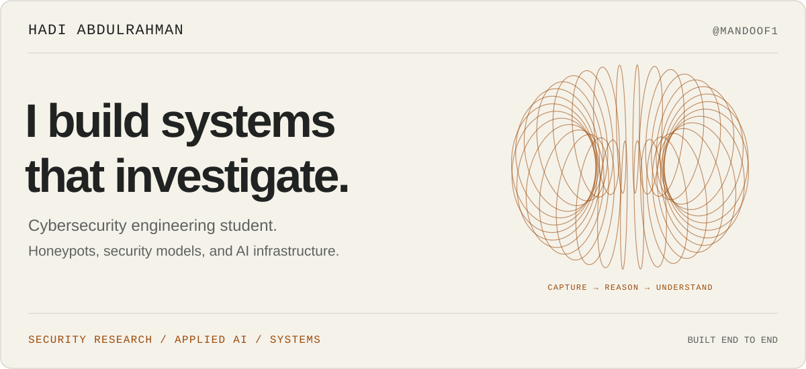
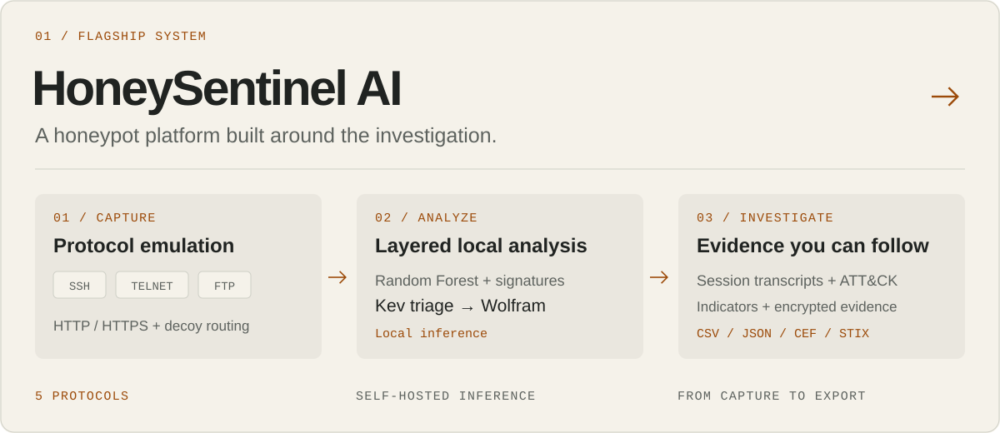
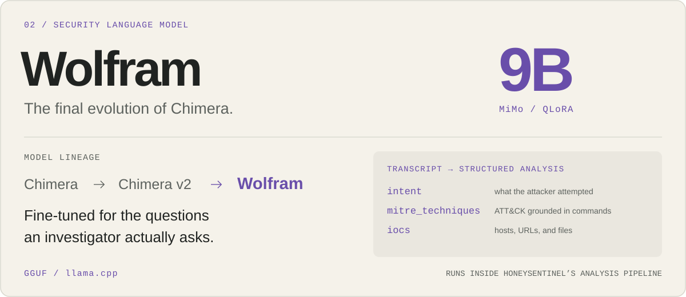
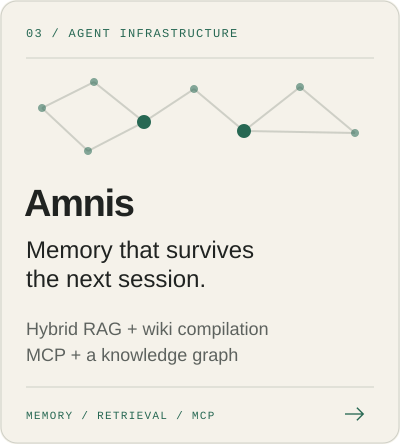
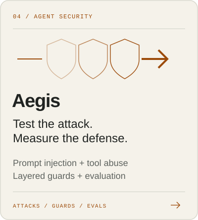
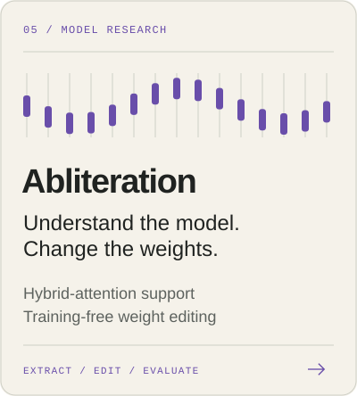
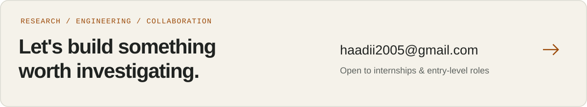

<picture>
  <source media="(max-width: 600px) and (prefers-color-scheme: dark)" srcset="assets/hero-mobile-dark.svg" />
  <source media="(max-width: 600px)" srcset="assets/hero-mobile-light.svg" />
  <source media="(prefers-color-scheme: dark)" srcset="assets/hero-dark.svg" />
  
</picture>

  <a href="#flagship-work">Flagship work</a> &nbsp; / &nbsp;
  <a href="#research-and-infrastructure">Research</a> &nbsp; / &nbsp;
  <a href="mailto:haadii2005@gmail.com">Get in touch</a>

I'm **Hadi**, a cybersecurity engineering student working where **security, machine learning, and systems engineering** meet. I build the full path: capture attacker behavior, analyze the evidence, and give an investigator something useful to work with.

**Open to cybersecurity internships and entry-level roles.** My projects are open source, designed for research and authorized testing, and built to run on infrastructure I control.

## Flagship work

<a href="https://github.com/mandoof1/honeypot-ui">
  <picture>
    <source media="(max-width: 600px) and (prefers-color-scheme: dark)" srcset="assets/honeysentinel-mobile-dark.svg" />
    <source media="(max-width: 600px)" srcset="assets/honeysentinel-mobile-light.svg" />
    <source media="(prefers-color-scheme: dark)" srcset="assets/honeysentinel-dark.svg" />
    
  </picture>
</a>

**HoneySentinel AI** captures attacker interactions across **SSH, Telnet, FTP, HTTP, and HTTPS** and turns them into encrypted evidence. Its investigation workspace brings together session transcripts, ATT&CK mappings, indicators, and exports for downstream tools.

The self-hosted deployment blocks outbound traffic from the honeypot engine and separates ingestion from the API. **Wolfram enriches captured transcripts through local inference.**

**[Explore the system →](https://github.com/mandoof1/honeypot-ui)** &nbsp; · &nbsp; [Architecture & deployment](https://github.com/mandoof1/honeypot-ui#self-hosted-deployment) &nbsp; · &nbsp; [Evaluation & measurements](https://github.com/mandoof1/honeypot-ui#evaluation)

 

<a href="https://github.com/mandoof1/wolfram">
  <picture>
    <source media="(max-width: 600px) and (prefers-color-scheme: dark)" srcset="assets/wolfram-mobile-dark.svg" />
    <source media="(max-width: 600px)" srcset="assets/wolfram-mobile-light.svg" />
    <source media="(prefers-color-scheme: dark)" srcset="assets/wolfram-dark.svg" />
    
  </picture>
</a>

**Wolfram is the final evolution of my Chimera project.** Built on **MiMo-V2.6-Distill-Qwen-9B**, it is fine-tuned for security analysis: what an attacker intended, which objectives and ATT&CK techniques the commands support, and which indicators appear in the transcript.

The project covers **fine-tuning, evaluation, GGUF deployment, and local integration with HoneySentinel**. The application validates technique IDs and checks extracted indicators against captured transcripts.

**[Explore Wolfram →](https://github.com/mandoof1/wolfram)** &nbsp; · &nbsp; [See the integration](https://github.com/mandoof1/honeypot-ui/blob/main/backend/app/ai/llm.py)

## Research and infrastructure

  <a href="https://github.com/mandoof1/amnis"><picture><source media="(prefers-color-scheme: dark)" srcset="assets/amnis-dark.svg" /></picture></a>
  <a href="https://github.com/mandoof1/aegis"><picture><source media="(prefers-color-scheme: dark)" srcset="assets/aegis-dark.svg" /></picture></a>
  <a href="https://github.com/mandoof1/abliteration"><picture><source media="(prefers-color-scheme: dark)" srcset="assets/abliteration-dark.svg" /></picture></a>

## Across the stack

**Systems & security** — Python · Go · C/C++ · Linux · Docker · Protocol emulation · MITRE ATT&CK 
**Models & agents** — PyTorch · Transformers · QLoRA · llama.cpp · Hybrid RAG · MCP 
**Applications & data** — TypeScript · React · FastAPI · PostgreSQL · Redis · SQLite

 

<a href="mailto:haadii2005@gmail.com">
  <picture>
    <source media="(max-width: 600px) and (prefers-color-scheme: dark)" srcset="assets/contact-mobile-dark.svg" />
    <source media="(max-width: 600px)" srcset="assets/contact-mobile-light.svg" />
    <source media="(prefers-color-scheme: dark)" srcset="assets/contact-dark.svg" />
    
  </picture>
</a>
