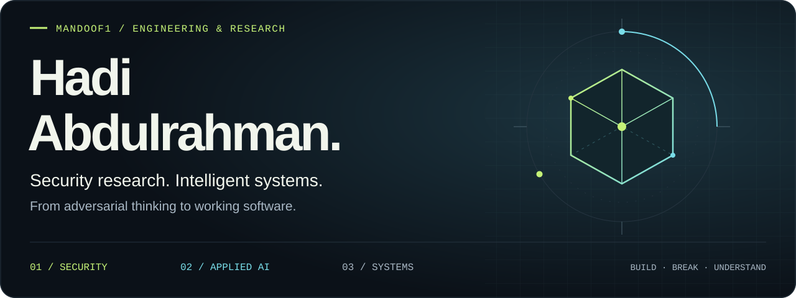
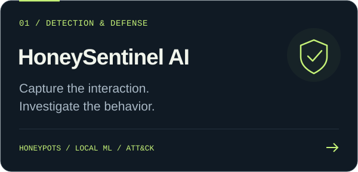
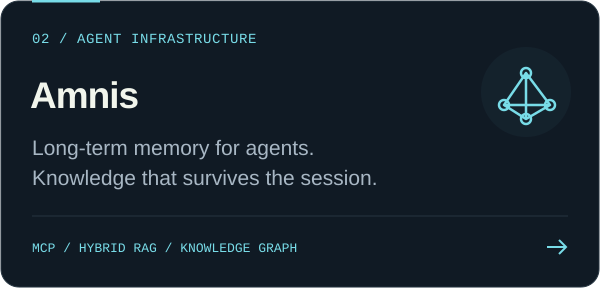
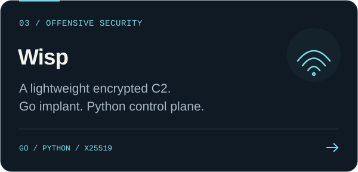
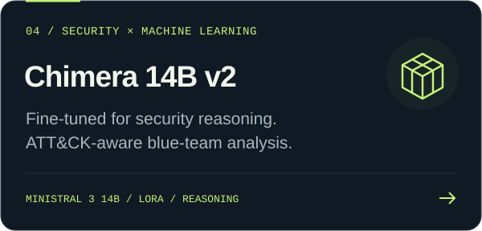
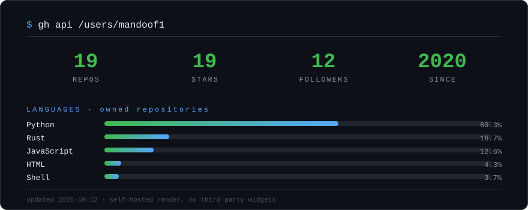

  <picture>
    <source media="(max-width: 600px)" srcset="assets/banner-mobile.svg" />
    
  </picture>

  <a href="mailto:haadii2005@gmail.com">Email me</a> &nbsp; / &nbsp;
  <a href="#selected-work">Explore my work</a> &nbsp; / &nbsp;
  <a href="https://github.com/mandoof1?tab=repositories">All repositories</a>

I'm **Hadi**, a **cybersecurity engineering student** who learns by building things end to end. I build tools to understand how systems break, make sense of what happens, and turn that understanding into better software.

My work connects **offensive security, detection engineering, and applied AI** — from encrypted C2 frameworks and honeypot investigations to fine-tuned models and persistent memory for agents. I work across the stack, building for research and authorized testing, with a preference for open source and systems I can run myself.

**Open to cybersecurity internships and entry-level roles.**

## Selected work

  
  
  
  

**AI security research:** [Aegis](https://github.com/mandoof1/aegis), a reproducible prompt-injection and guardrail benchmark for tool-using agents; and [Abliteration](https://github.com/mandoof1/abliteration), training-free refusal-ablation research on hybrid-attention models.

**Also in the workshop:** [Aether](https://github.com/mandoof1/aether), a local-first desktop AI agent; [Browseye](https://github.com/mandoof1/browseye), Firefox control over WebSocket; and [Chimera 14B](https://github.com/mandoof1/chimera-14b), a LoRA combining tool calling with extended reasoning.

## What I work with

| Area | Tools & interests |
| :--- | :--- |
| **Code** | Python · Go · C / C++ · TypeScript · Bash · SQL |
| **Security** | Vulnerability research · C2 development · Honeypots · Detection · MITRE ATT&CK |
| **AI** | LoRA fine-tuning · RAG · Agent memory · Tool calling · MCP |
| **Systems** | Linux · Docker · FastAPI · PostgreSQL · Redis · Nginx · Raspberry Pi |

  
<strong>A little more of the work</strong>

- [TuffyRAT C2](https://github.com/mandoof1/tuffyrat-c2) — Python control server and C++17 Windows agent for authorized red-team operations.
- [Exim RCE research](https://github.com/mandoof1/Exim-Remote-Code-Execution) — remote code execution research against the Exim mail server.
- [WiFi Pentest Assistant](https://github.com/mandoof1/WiFi-Pentest-Assistant-Script) — Bash tooling for authorized wireless assessments.
- [Pi-hole UAE](https://github.com/mandoof1/pi-hole-uae) — regional ad and tracker blocking for a self-hosted network.
- [Arch Optimization Script](https://github.com/mandoof1/Arch-Optimization-Script) — post-install tuning for Arch Linux.
- [Pi media pipeline](https://github.com/mandoof1/pi-media-pipeline) — a documented Raspberry Pi 5 media setup.

  
<strong>GitHub activity & languages</strong>

   
  
    
  

 

<a href="mailto:haadii2005@gmail.com"><picture><source media="(max-width: 600px)" srcset="assets/contact-mobile.svg" /></picture></a>

Security research · Open source · Self-hosted systems

